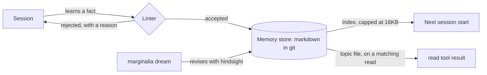

# How it works

Most plugins in this space bet on *capture everything, retrieve semantically*: embeddings, a vector store, an LLM summarising every turn. Marginalia bets the other way: **high-precision capture with a visible feedback loop, and retrieval that costs nothing until it is relevant.**

So it keeps a small index in front of the agent all the time, and everything else out of the way until the agent opens the code it describes.



- [Three scopes](#three-scopes)
- [The context budget](#the-context-budget)
- [Topic files](#topic-files)
- [Keeping memory true](#keeping-memory-true)
- [What it costs](#what-it-costs)

## Three scopes

Each scope has its own `MEMORY.md`, an index with one line per fact.

| Scope | Holds | Shown to the agent as |
|---|---|---|
| `user` | the person: preferences, working style, their machines | About you |
| `global` | knowledge that outlives any one repository: other tools, APIs, hosts | Across projects |
| `project` | this repository | the repository's name |

A fact is filed by **what it is about**, not where it was learned.

The split was learned the hard way. With only "global" and "project", every cross-project API quirk landed in the scope labelled *About the user*, and a profile that should have shaped how the agent works was never written at all.

## The context budget

The block injected at session start is capped at 16KB (about 4,000 tokens) and reports its own cost, so the tax is never invisible.

Each section is guaranteed a share of what is left of that cap after the protocol and headings. Shares are handed out in priority order:

| Priority | Section | Share | Why it sits here |
|---|---|---|---|
| 1 | the profile (`user`) | 40% | it changes how the agent works rather than what it knows |
| 2 | this project | 30% | its facts are the most actionable |
| 3 | cross-project knowledge | 15% | |
| 4 | the listing of topic files | 15% | it is a map, and `memory_search` covers what it leaves out |

A share is a floor, not a ceiling, so a section takes whatever the others do not need. A store holding only a profile gives the profile the whole budget.

When an index outgrows its share it is cut from the bottom, and writing to it says so ("session start shows 20 of 103 entries"). The topic listing degrades the same way: topics that bear on this repository in full, the rest by name, then a count. `memory_search` finds whatever the block leaves out.

That order was learned the hard way too. The listing used to sit outside the budget, and once a store held about 25 topic files it pushed out every entry. One store showed none of its 49 profile entries for six weeks, and then told the agent no memory had been recorded.

## Topic files

Detail that does not fit on one line goes in a topic file next to the index. Give it a `paths` glob and it is added to the `read` tool result, once per session, whenever the agent opens a matching file. Zero tokens until you touch that code.

```markdown
---
description: Belt solver profiling
paths: ["src/solver/**"]
---
Profiling shows 78% of time in Array allocation inside beltStep().
Preallocate a scratch buffer instead of returning fresh arrays.
```

Globs are tried relative to the repository root and against the absolute path, and `~/` is your home directory, so a cross-project topic can name files in another repository or under `~/.config`. `memory_write` warns about a glob that matches no tracked file.

At most 2KB of a topic is attached this way. A longer one is cut, with a pointer to `memory_read` for the rest.

## Keeping memory true

**Provenance.** Every entry carries the date, the session and the agent that produced it. `marginalia why <text>` shows the conversation behind a fact, with the command to resume it.

**Staleness.** Entries older than 90 days render as `[unverified since …]`, so the agent revalidates instead of trusting blindly. The `user` scope is exempt: a preference does not expire on a clock, it expires when you contradict it.

**Contradictions.** Writing a fact surfaces similar existing ones, so they get reconciled rather than silently duplicated.

**Negative memory.** Approaches that *failed* are first-class (`✗`). Agents re-try dead ends constantly, and recording them is often worth more than recording successes.

**A durability linter.** A write to the index is rejected, with a reason, when it:

- looks like a credential, or assigns one a value;
- is longer than 200 characters (detail belongs in a topic file);
- contains a commit SHA;
- contains a `file:line` reference;
- describes a transient state ("currently", "for now", "today").

There is no override flag. Facts that need a SHA belong in a topic file, not the index.

## What it costs

Memory is injected into every turn, so the price should be visible rather than implied. `marginalia inspect` prints the current total. On an empty store it breaks down like this:

| Part | Tokens | |
|---|---|---|
| protocol | ≈295 | always injected: what memory is for and how to file it |
| about you | ≈0 | 0 entries |
| across projects | ≈0 | 0 entries |
| this project | ≈0 | 0 entries |
| topic index | ≈0 | 0 files |
| wrapper | ≈15 | headings and tags |
| **total** | **≈310** | in every session, every turn |

The shape is a **fixed floor of roughly 310 tokens, then about 20 tokens per fact, up to a ceiling of about 4,000.** On an empty store about 95% of the cost is the protocol, which says what memory is for rather than when to save. That floor buys the behaviour; without it nothing gets captured. Once a section is cut, `marginalia inspect` says how much of it is shown.

Two things are deliberately *not* in that number:

- **Topic file bodies.** A file with `paths` is injected only into the `read` result for a matching file. Ten topic files cost the same as zero until you open the code they describe.
- **Entries past the cap.** They stay in the index and `memory_search` finds them, but session start does not show them. Pruning, or a [dream](dreaming.md), is what brings them back into view.
